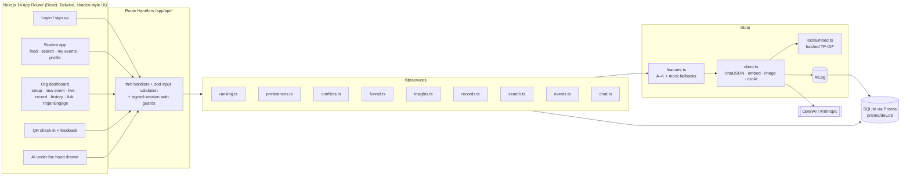

# TrojanEngage 🏛️

**Students swipe, orgs learn, and every event makes the next one better.**

TrojanEngage is an AI-powered event platform for USC student orgs and students. An org creates an event → AI writes the swipe card and flyer → students swipe (every left swipe captures a reason) → students pre-register, register, check in by QR and leave 10-second feedback → AI writes the event record → approved records and swipe insights pre-fill the org's next event.

**Two ways to use it on a phone:** the web app is installable (PWA, "Add to Home Screen"), and `mobile/` holds a native **Expo** student app that talks to the same backend.

**Students log in once** (they stay signed in) with a USC email. Their **class schedule is imported** automatically, events are checked against it, and **My Events is a calendar**. Orgs get **Ask TrojanEngage**, a chatbot over their event history that saves every prompt and answer and uses feedback only from students who registered **and** checked in.

The full demo works **with no API key**: every AI feature has a deterministic, template-based fallback, and embeddings fall back to a local TF-IDF vectorizer.

---

## Quick start

```bash
npm install && npx prisma migrate dev && npx prisma db seed && npm run dev
```

Then open http://localhost:3000.

**Demo logins:** students are `alex@usc.edu` (new, not onboarded), `priya@usc.edu`, `sofia@usc.edu`, `arjun@usc.edu`, `marcus@usc.edu`, `emily@usc.edu`, `jamal@usc.edu` and `aisha@usc.edu`, all with password **`trojan123`**. New students can sign up with any `@usc.edu` email. Orgs (AI@USC, ISA, WiC) use the demo switcher in the top bar.

- Node 18.18+ (Node 20 LTS recommended).
- `.env` is included and set to `AI_PROVIDER="mock"`. Copy `.env.example` → `.env` if you need to start over.
- If `prisma migrate dev` asks you to name a new migration, press Enter (it means your Prisma version produced slightly different SQL). `npx prisma db push` also works.
- Re-seed any time with `npx prisma db seed`. It wipes the data first and puts the dates back relative to today, so the "live" event is always today.
- Phone check-in: run `npm run dev -- -H 0.0.0.0` and open the QR on a phone on the same Wi-Fi, using your laptop's LAN IP instead of `localhost`.

### Turning on real AI

```bash
# .env
AI_PROVIDER="openai"          # or "anthropic"
OPENAI_API_KEY="sk-..."       # also enables text-embedding-3-small (+ optional images)
ANTHROPIC_API_KEY="sk-ant-..."
AI_MODEL=""                   # optional override: defaults gpt-4o-mini / claude-sonnet-4-5
AI_IMAGES="1"                 # optional: flyer art via gpt-image-1 (saved to /public/generated)
EMBEDDINGS_PROVIDER="auto"    # auto | openai | local
AUTH_SECRET="any-long-random-string"   # signs student session cookies (set one before deploying)
```

If a call fails (no network, bad key, invalid JSON twice), the feature quietly uses its template fallback and the "AI under the hood" drawer marks it **fallback**. After switching embedding providers, re-run the seed so seeded and new vectors share one space. Mixed vector sizes are still handled: similarity falls back to local vectors.

---

## Architecture



**The loop in data terms:** `Event` → `Swipe` (direction + reason) → `Registration` (pre-registered → registered, with a conflict flag) → `CheckIn` → `Feedback` → `EventRecord` (markdown + stats + themes + keep/change + embedding) → RAG for the next `Event`.

```
app/
  api/…                     Route handlers (thin; zod-validated)
  student/{setup,feed,search,events,profile}
  org/{setup,new,history,events/[id]/live,events/[id]/record}
  event/[id]  checkin/[id]  feedback/[id]
components/                 UI kit (components/ui), swipe card, flyer, charts, AI drawer
lib/
  ai/        client.ts (provider layer) · features.ts (A–K) · schemas.ts (zod) · localEmbed.ts · log.ts
  services/  ranking · preferences · conflicts · funnel · insights · records · search · events
prisma/      schema.prisma · migrations/ · seed.ts
```

---

## AI features

Every function goes through `runAI()` in `lib/ai/client.ts`. It calls the LLM, validates the reply with zod, retries once on invalid JSON or a schema mismatch, then falls back to the template. Every call, including embeddings, is logged to `AiLog`.

| # | Feature | Model | Input | Output | Fallback |
|---|---|---|---|---|---|
| A | `extractPastEvents` | gpt-4o-mini / claude-sonnet-4-5 | Pasted docs, notes, CSV (.txt/.md/.csv upload) | `{events:[{title,date,startTime,endTime,eventType,budget,capacity,attendance,rating,tags,notes…}]}` shown in an editable review table | Regex parser for dates/times/$/capacity/attendance + CSV sections anywhere in the text |
| B | `generateCard` | chat model (+ `gpt-image-1` if `AI_IMAGES=1`) | Event draft | `{headline≤50, tagline≤80, blurb≤140, tags 3–6 (fixed taxonomy), color hex, imagePrompt}` | Title/description templates, keyword tagging, color by event type, CSS gradient flyer |
| C | `qualityCheck` | chat model | Event draft | `[{field, issue, fix, suggestedValue, severity}]` with one-click fixes | Rules: vague description, food without dietary info, accessibility not stated, missing location, generic title, > 3h, unexplained ticket cost |
| D | Embeddings | `text-embedding-3-small` | Event = title + description + tags + type; profile = interests + goals + top tags; records | `number[]` (cosine in JS) | `localEmbed.ts`: hashed TF-IDF (384-d, bigrams, taxonomy expansion) |
| E | Ranking | none (pure math) | Profile + tag weights + goals + free slots + friends | Score + "why you're seeing this" from the top 2 factors | — (always deterministic) |
| F | Preference learning | none | Swipes, reasons, confirmations, ratings | Updated `tagWeights`, `profileEmbedding = norm(0.7·old + 0.3·event)` | — |
| G | `explainProfile` | chat model | Tag weights, recent swipes, reasons | One friendly sentence (cached, refreshed every 5 swipes) | Template from top topics, time-of-day, size and food patterns |
| H | `suggestPlan` (RAG) | chat model + embeddings | Draft + top-3 approved records by similarity + org swipe insights + venues | `{prefill:{budget,capacity,venue,date,time,food,goodies}, suggestions:[{title,detail,source:recordId}]}`; uncited suggestions are dropped | Numbers-first template, e.g. "60% swiped left because of the time — try Thursday 6pm" |
| I | `orgInsights` | chat model | Left-swipe reason counts per event, right-swipe rates, best slot | 2–5 rewrite tips | Rule-based tips per dominant reason |
| J | `clusterFeedback` | chat model | Ratings, tags, comments | 3–5 themes `{theme,count,sentiment,quote}` | Group by feedback tag, pick a representative comment |
| M | `summarizeEvent` | chat model | Event incl. agenda, restrictions, format, campus, co-hosts, spots left | `{overview, whatYoullDo[], goodToKnow[], whoItsFor}` (cached on the event, cleared on edit) | Template from the event fields + agenda |
| L | `orgChat` (Ask TrojanEngage) | chat model + embeddings | Question + recent conversation + top-3 relevant past events (title mentions first, then embedding similarity): funnel, left-swipe reasons, record keep/change, and **verified attendee feedback only** | Markdown answer + cited event ids; Q&A saved to `ChatMessage` | Intent-based answer (timing · food · attendance · why students passed · what to change · feedback summary) built from the same data, with real numbers and quotes |
| K | `generateRecord` | chat model | Event, funnel stats, left-swipe reasons, themes | Markdown (Overview · What was planned · Funnel · Why students passed · Attendance vs capacity · What students said · Keep / Change) + keep[] / change[] | Full markdown template filled from the data |

**Ranking formula** (`lib/services/ranking.ts`):

```
score = 0.35·cosine(profile, event) + 0.25·tagWeightMatch + 0.15·goalMatch
      + 0.15·freeSlotFit + 0.10·min(friendsRightSwiped/3, 1)
      − penalties (conflict with a registration, disliked time slots, cost if cost-sensitive)
      + 0.05 "just posted" boost for events published in the last 24h
```

Already swiped and past events are excluded.

**Preference learning** (`lib/services/preferences.ts`):

- A right swipe adds +0.3 to each of the event's tags.
- A left swipe with reason topic or not-for-me subtracts 0.2.
- A left swipe for time, cost or unclear doesn't touch topics. Those are tracked as slot and cost dislikes from the swipe log.
- Confirming a registration adds +0.1.
- Feedback rated ≥4 adds +0.2; rated ≤2 subtracts 0.1.

---

## Mobile

### Installable web app (PWA)
- `app/manifest.ts` + `public/sw.js` + icons make TrojanEngage installable. On Android/Chrome an **Install app** button appears in the top bar. On iPhone, open it in Safari → Share → **Add to Home Screen**.
- It opens full-screen (standalone), respects the notch (safe areas), caches build assets, and falls back to recently viewed pages and `/offline` on bad Wi-Fi. API data is never cached.
- To try it on your phone: `npm run dev:lan`, then open `http://<your-laptop-IP>:3000` on the same Wi-Fi.

### Native student app (Expo) — `mobile/`
Screens: login (token in the device keychain, so you stay signed in) → onboarding (interests, goals, imported classes) → swipe feed (match %, "why", clash warnings, left-swipe reasons) → event details (AI summary, agenda, register with clash warning, check-in) → My Events (week strip + day timeline of classes/work/events, saved list with Register) → schedule editor (classes read-only; add/edit/delete your own busy time) → multi-select feedback → profile.

```bash
# terminal 1 — the backend (project root)
npm run dev:lan
# terminal 2 — the app
cd mobile
cp .env.example .env            # set EXPO_PUBLIC_API_URL=http://<your-laptop-IP>:3000
npm install
npx expo install --fix          # aligns react / react-native / expo-* to your Expo SDK
npx expo start                  # scan the QR with Expo Go (iOS/Android)
```
The app targets Expo SDK 58. If your Expo Go is on a different SDK, `npx expo install expo@^<your-sdk> --fix` re-aligns everything.

## Schedules, conflicts & availability

- **Class import:** on first login (or signup) with a USC email, the student's classes are imported. A deterministic stand-in for the USC registrar feed (`lib/services/schedule.ts`) generates plausible sections by major (CSCI 570, BUAD 304, DSCI 552…). Imported classes are **read-only**. Students can only add, update or delete their own **work / personal / other** blocks, on or off campus. "Sync" re-imports classes and leaves personal blocks alone.
- **Free time** is derived automatically (8am–10pm minus busy blocks) and feeds ranking. Nobody types in their free time any more.
- **Student conflicts:** each card, event page and registration is checked against classes, work and personal blocks, and other events, including multi-day events. Students see a warning listing every clash and can **register anyway**. The clash stays flagged on the calendar.
- **My Events calendar:** a week view showing classes (grey), work (blue), personal (purple), registered events (cardinal), saved events (dashed gold) and free time (green). Below it, the Saved list has a Register button, plus Registered (with waitlist status) and Past.
- **Waitlist:** when an event is full, new registrations are waitlisted (`waitlistEnabled`).
- **Org conflicts & availability** (`POST /api/events/availability`, shown live while planning an event and on its detail page):
  - other campus events at the same time (yours or other orgs', flagged when they target the same audience)
  - **venue double-booking**
  - the **% of students interested in the event's tags who are actually free**, with how many are in class, at work or at other events
  - one-click **better slots** that week

## Personalization

- Each swipe stores its context: `matchPct`, `rankPos`, `dwellMs` (time on screen) and `source` (feed, search or detail).
- Besides topic weights, the student learns **time-slot weights** (`slotWeights`) and **event-type weights** (`typeWeights`) from swipes and feedback. A right swipe adds weight to that slot and type. A left swipe for time lowers the slot, and one for topic lowers the type. Ratings of 4 or higher add weight, and a "bad timing" tag lowers the slot.
- Ranking adds small boosts or penalties for those preferences and penalizes class or work clashes.
- **Match %** on every card measures interest only: topic weights, profile similarity, goals and type preference. It's separate from the overall rank, which also weighs timing and friends.

## Campus event coverage (DB)

I checked how USC events actually work before changing the schema. EngageSC and calendar.usc.edu filter by type, audience and campus, and group calendars include members-only events. HackSC runs multi-day hackathons (3 days of workshops plus a 24–36h hack) and went virtual in 2021. Some events are off-campus with shuttles (e.g. ISI Marina del Rey), some are 18+, and orgs often co-host. The old schema couldn't represent these, so `Event` gained:

| Field | Why |
|---|---|
| `endDate` | Multi-day hackathons, conferences, festivals (conflicts and calendar span every day) |
| `format` + `virtualUrl` | In-person / hybrid / virtual (link shown to registered students) |
| `campus` | UPC, HSC, off-campus, online |
| `visibility` | Public vs members-only (GBMs) |
| `restrictions` | USC ID required, 18+, 21+, members only, RSVP required, waiver |
| `coHosts` | Org × department collabs |
| `agenda` | Run of show / multi-session schedules (used in the AI summary) |
| `registrationUrl` | External RSVP (EngageSC, lu.ma, Google Form) |
| `waitlistEnabled` | Capacity-limited events |
| `detailedSummary` | Cached AI summary for students |

`eventType` now covers 23 kinds: workshop, social, cultural, career, talk, sports, performance, exhibition, screening, hackathon, competition, info-session, fair, conference, volunteering, wellness, faith, fundraiser, general-meeting, watch-party, trip, academic and other. The tag taxonomy added arts, film, comedy, faith, advocacy and sustainability. Feedback tags added great speakers, made friends, hard to find and would come again. The seed includes a 36h buildathon (multi-day, 18+, agenda, co-host), a hybrid fireside, an HSC-campus talk, a members-only GBM, and **two live events at once**.

## Auth, feedback rules & chatbot

**Student auth** (`lib/auth.ts`, `lib/session.ts`, `middleware.ts`):
- Passwords are hashed with scrypt (`node:crypto`, no extra dependencies).
- The session cookie is HMAC-signed and httpOnly. `/student/*`, `/feedback/*` and `/checkin/*` redirect to `/login` when nobody is logged in.
- **Stay signed in:** cookies last a year and are refreshed on every visit ("Keep me signed in" is on by default). The Expo app keeps the same token in the device keychain and sends it as `Authorization: Bearer`.
- Every student API checks the signed session and that the student is only touching their own data (401 if not logged in, 403 for someone else's data). The org switcher can't impersonate a student.

**Feedback only from verified attendees (multi-select):** students pick up to 4 tags (`Feedback.tags`). Themes, records and the chatbot count every selected tag.
- `POST /api/feedback` returns 403 unless the student is registered **and** checked in (QR check-in marks walk-ins as registered).
- Students are prompted for it: the feed shows a "How was … ?" card for each event they checked in to but haven't rated, and My Events shows a "Give feedback" button.

**Ask TrojanEngage** (`/org/chat`, `lib/services/chat.ts`):
- **Responses are ordered by rating:** events with the highest verified-attendee rating come first, and quotes run from highest to lowest rated, each with its ★ rating.
- Every question and answer is stored per org in `ChatMessage`, so next year's board can scroll back through them. Clear the history with the trash button.
- Answers cite their source events, and the chips link to each event's record.
- Short follow-ups like "and the food?" carry over the previous question.

## Demo script (works with and without an API key)

> Tip: open **AI under the hood** (top bar) at any point to see each call: feature, model, latency, and whether it used the fallback.

0. **Phone:** install the web app (Add to Home Screen) or run the Expo app from `mobile/` (see Mobile above).
1. **Student onboarding & swiping:**
   - Click **Log in** and use the **Alex (new student)** demo chip (`alex@usc.edu` / `trojan123`). His CS class schedule is imported on this first login, and setup step 3 shows it.
   - Every card shows a **% match**. Tap **Full details & summary** for the AI summary, agenda and clashes.
   - Swipes now **save** events. In **My Events** the calendar shows classes and saved events. Tap **Register** on a saved event that overlaps a class or another event: the clash warning lists everything, and **Register anyway** goes ahead.
   - Under **Schedule**, add a work shift (classes are locked) and watch the calendar and clash flags update.
   - In setup, choose interests (AI / ML, Coding, Food), goals (Learn skills, Free food), then **+ Weekday evenings**, then **Build my feed**.
   - The cards show "Why you're seeing this" lines and friend avatars ("Priya + 2 friends interested").
   - Swipe 8 events, 2 of them left. Each left swipe opens the reason sheet.
   - Swipe right on both **LLM Paper Reading Group** and **WiC x Google: Breaking into ML Careers**: the second one shows a ⚠ conflict chip in the toast.
   - After the 5th swipe, the **"Your feed just got smarter"** banner shows the AI profile sentence and the remaining cards re-rank.
2. **Live events:** AI@USC has **two live events** — switch between them with the tabs at the top of the live dashboard.
   **Live event:**
   - Switch to **AI@USC** in the top bar. On History, click **Live now: Prompt Engineering Lab**.
   - Show the big QR (click it for full screen), then **Simulate 20 attendees**. The counters and funnel chart update (polling every 3s).
3. **Close & record:**
   - Click **Close event**. The AI record generates with the funnel and its conversion %, left-swipe reasons and feedback themes.
   - Edit it in the **Edit** tab, then **Approve**. Approval embeds the record so it can power RAG.
4. **New event:** (now with format, campus, members-only, requirements, co-hosts, a multi-day end date and an agenda). The **Availability & conflicts** panel updates as you change the date, time or venue: % of interested students free, clashes, venue double-booking, and better slots you can click.
   Open any event from History for its **detail page with Edit**. Published events can be edited and saved in place.
   - Go to **New event**. Title "Build Your First AI Agent", type workshop. Enter a **budget** (e.g. 400) and venue cards appear.
   - Click **Pre-fill from history**. The fields fill in (highlighted), and the top suggestion reads **"60% swiped left because of the time — try Thursday 6pm"**, with a citation chip linking to the *Intro to LLMs Workshop* record.
   - Click **Check quality** and apply the one-click fixes.
   - Click **Generate card** to get the live swipe-card preview and a printable flyer with a QR code. Then **Publish**.
5. **Back to the student:** log in as Alex again. The new event appears at or near the top of the feed with its "why" line and a **New** badge.
6. **Ask TrojanEngage:** as AI@USC, open **Ask TrojanEngage** and click "Why did students skip the Intro to LLMs Workshop?", then "When should we schedule our next workshop?". As ISA, ask "What did attendees say about the food at Diwali Night?". Answers cite their events and are saved to the chat history.
7. **AI under the hood:** open the drawer and walk through every call that was made.

**Also worth showing:**

- **Setup & import:** click "Use sample notes", then **Extract events**, edit the review table, and confirm.
- **History:** the timeline with mini funnels, ratings and records, the "Why students pass" chart, best time slots and AI rewrite tips.
- **Student pages:** Search (hybrid keyword + semantic, with filters), My Events (confirm, conflicts, check in), and Profile (top-tags chart, editable interests, goals and free time).

### Seed data

`prisma/seed.ts` is deterministic, and its dates are relative to today. It creates:

- 3 orgs (AI@USC, Indian Students Association, Women in Computing) and 8 venues.
- 20 upcoming events over the next 3 weeks, 1 **live** event today (Prompt Engineering Lab), and 6 past events with approved records:
  - **Intro to LLMs Workshop** (Fri 8pm; 60% of left swipes said "time")
  - **PyTorch Hands-on Night** (Thu 6pm, the best slot)
  - **AI Ethics Panel**
  - **Diwali Night 2025** ("start earlier", "shorten the speeches", "loved the food")
  - **Holi on the Lawn**
  - **Resume Review & Recruiter Mixer**
- 8 demo students with logins (`<firstname>@usc.edu` / `trojan123`) and 12 friendships. Alex is un-onboarded for the demo.
- 90 background students (hidden from the switcher) to give past events realistic volume.
- About 550 swipes with reasons, plus registrations, check-ins and about 80 feedback comments. Tag weights and profile embeddings are pre-computed from those swipes.

Venue capacities, costs and accessibility flags are illustrative demo data.

---

## API

| Method | Route | Purpose |
|---|---|---|
| POST | `/api/auth/login`, `/api/auth/signup`, `/api/auth/logout` | Student auth (signed httpOnly cookie) |
| GET/POST | `/api/session` | Current session; POST = demo **org** switcher only |
| GET | `/api/students/[id]/pending-feedback` · `/api/feedback/eligibility?eventId=` | Checked-in events awaiting feedback · can this student rate this event? |
| GET/POST/DELETE | `/api/orgs/[id]/chat` | Ask TrojanEngage history · ask (stored) · clear |
| GET/POST | `/api/students/[id]/schedule` · POST `/api/students/[id]/schedule/import` | Schedule (classes + own blocks + derived free time) · add block · re-sync USC classes |
| PATCH/DELETE | `/api/schedule/[blockId]` | Edit / delete own block (imported classes → 403) |
| POST | `/api/events/[id]/save` · `/api/events/[id]/register` `{force}` · `/api/registrations/[id]/confirm` `{force}` | Save · register (409 + conflicts unless `force`) · waitlist when full |
| GET | `/api/events/[id]/summary` | AI detailed summary |
| POST | `/api/events/availability` | Campus clashes, venue double-booking, % interested students free, better slots |
| GET | `/api/orgs/[id]/live` | All of an org's live events |
| POST | `/api/students/[id]/setup` | Interests, goals, free slots → tag weights + profile embedding |
| GET | `/api/students/[id]/feed` | Ranked events with score, why, friends, conflict |
| GET | `/api/students/[id]/profile` | Tag weights, top tags, cached AI sentence (`?refresh=1`) |
| GET | `/api/students/[id]/events` | Registrations with conflict flags |
| GET | `/api/search?q=&type=&audience=&free=&food=&from=&to=` | Hybrid search |
| POST | `/api/swipes` | Save swipe, learn, pre-register + conflict check; returns `smarter` every 5 swipes |
| POST / DELETE | `/api/registrations/[id]/confirm`, `/api/registrations/[id]` | Confirm (+boost) / cancel |
| POST | `/api/checkin`, `/api/feedback` | Attendance (logged-in student); feedback requires registered + checked in |
| GET/PATCH | `/api/orgs/[id]` | Org profile |
| POST | `/api/orgs/[id]/import`, `/api/orgs/[id]/import/confirm` | AI extraction → review → save as closed events + records |
| POST | `/api/events` · PATCH `/api/events/[id]` · POST `/api/events/[id]/publish` | Draft → edit → publish (embedding) |
| POST | `/api/events/suggest-venue`, `/api/events/prefill` | Venue helper, RAG plan |
| POST | `/api/events/[id]/generate-card`, `/api/events/[id]/quality-check` | Card + flyer copy, quality issues |
| GET | `/api/events/[id]/live` | Funnel counts + recent check-ins (polled every 3s) |
| POST | `/api/events/[id]/simulate` `{n}` | DEV: n fake attendees with check-ins + feedback |
| POST | `/api/events/[id]/close` · GET/POST `/api/events/[id]/record` | Close → record draft / fetch / regenerate |
| GET/PATCH | `/api/records/[id]` · POST `/api/records/[id]/approve` | Edit + approve (embedding) |
| GET | `/api/orgs/[id]/history`, `/api/orgs/[id]/insights` | Timeline + insights |
| GET | `/api/ai/logs`, `/api/venues` | Latest 50 AI calls, venues |

## Out of scope

Org logins (orgs use the demo switcher), password reset/SSO, approval workflows, cross-org sharing, maps, push notifications, payments, scribble-to-event input, recruitment.
